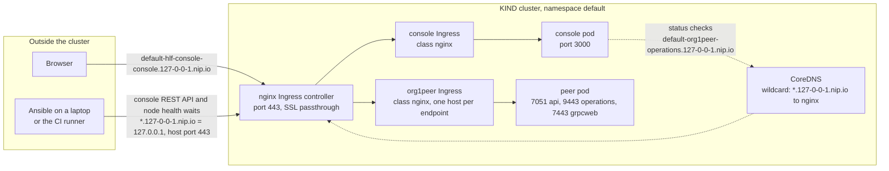
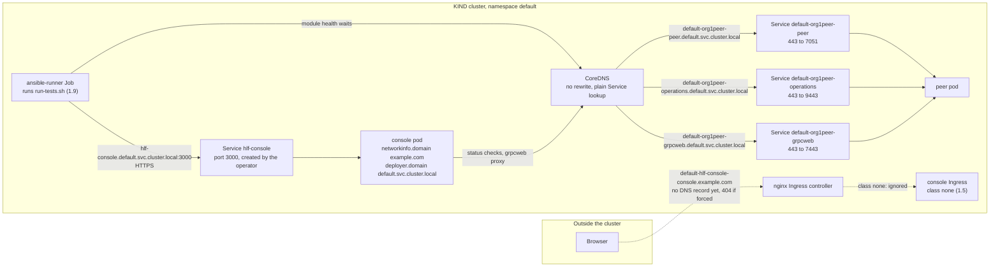
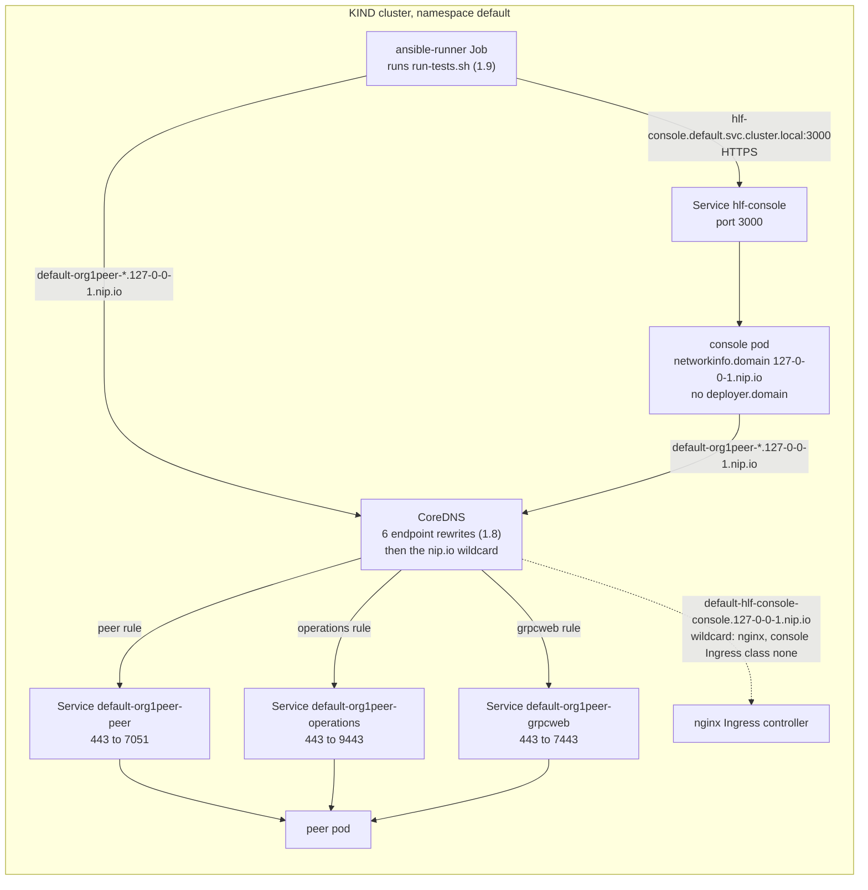

# Step 1 — Scenarios A, B and C

Diagrams of the three scenarios handled by
[`MIGRATION-STEP-1.md`](./MIGRATION-STEP-1.md#scenarios) (design:
[`URL-MANAGEMENT-NEW.md`](./URL-MANAGEMENT-NEW.md) §4). Names are those of
the local KIND test cluster: namespace `default`, console `hlf-console`, one
peer `org1peer`.

## Scenario A — everything exposed (default)

## Scenario B — nothing exposed, cluster-local HLF domain (Step 1 target)

## Scenario C — nothing exposed, previous FQDNs

